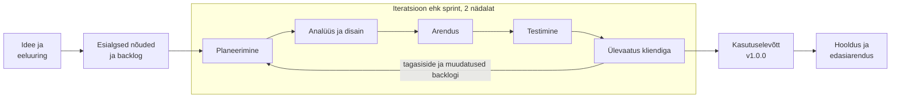

# 1. Tarkvara arendusprotsess

## 1.1 Etapid ideest hoolduseni

| Etapp | Eesmärk | Mida laohalduse projektis tehakse |
|---|---|---|
| 1. Idee ja eeluuring | Mõista probleemi ja otsustada, kas rakendust tasub teha | Vestlus Nurgapoe omanikuga: Exceli tabel ei näita õiget laoseisu, kaup saab otsa, aegunud toit jääb märkamata. Eesmärk: laoseis on alati õige ja juhataja saab hoiatuse enne, kui kaup otsa saab. |
| 2. Nõuete analüüs | Panna kirja, mida süsteem peab tegema ja millistel tingimustel | Kasutajalood ja nende vastuvõtukriteeriumid ([backlog](02-metoodika-ja-backlog.md)), [kasutusjuhtude skeem](../diagrams/kasutusjuhud.puml), mittefunktsionaalsed nõuded (vt allpool). |
| 3. Disain | Otsustada, kuidas süsteem üles ehitatakse | [Arhitektuur](04-arhitektuur.md), [andmemudel](../diagrams/andmemudel.puml), [andmevoog](../diagrams/andmevoog.puml), kasutajaliidese visandid. |
| 4. Arendus | Kirjutada kood | Iga kasutajalugu tehakse eraldi Giti harus, kood vaadatakse üle pull request'is ja ühendatakse `main` harusse. |
| 5. Testimine | Veenduda, et rakendus töötab ja vastab nõuetele | Ühiktestid (äriloogika, nt laoseis ei lähe alla nulli), integratsioonitestid (API + andmebaas), kliendi vastuvõtutest iga sprindi lõpus. |
| 6. Kasutuselevõtt | Viia rakendus päris kasutusse | Paigaldus serverisse, toodete import Exceli tabelist, töötajate koolitus, versioon 1.0.0. |
| 7. Hooldus | Hoida rakendus töös ja arendada edasi | Vigade parandused (PATCH-versioonid), uued soovid (MINOR-versioonid), turvauuendused, igapäevased varukoopiad. |

### Mittefunktsionaalsed nõuded

- Rakendus töötab tavalises brauseris nii arvutis kui tahvelarvutis, eraldi paigaldust ei ole vaja.
- Tavaline toiming (otsing, kauba väljastamine) võtab alla 2 sekundi.
- Samaaegselt kasutab rakendust kuni 10 inimest.
- Andmetest tehakse igal ööl varukoopia.
- Ligi pääsevad ainult sisse loginud töötajad, õigused sõltuvad rollist.
- Isikuandmeid hoitakse minimaalselt (töötaja nimi ja e-post), vastavalt isikuandmete kaitse üldmäärusele.

## 1.2 Arendusprotsessi mudelite võrdlus

**Koskmudel** läbib etapid üks kord ja kindlas järjekorras: järgmine etapp algab alles siis, kui eelmine on lõpetatud ja dokumenteeritud. Klient näeb töötavat rakendust alles projekti lõpus.

**Iteratiivne ja inkrementaalne mudel** kordab analüüsi, disaini, arendust ja testimist lühikeste tsüklitena (iteratsioonidena). Iga iteratsiooni lõpus on olemas töötav osa rakendusest (inkrement), mida klient saab proovida ja mille põhjal järgmist iteratsiooni muudetakse.

**V-mudel** on koskmudeli edasiarendus, kus igale arendusetapile vastab testimise etapp (nõuetele vastuvõtutest, disainile integratsioonitest jne). Nõuded peavad olema samamoodi alguses paigas.

| Tunnus | Koskmudel | V-mudel | Iteratiivne ja inkrementaalne |
|---|---|---|---|
| Etappide järjekord | kindel, üks kord | kindel, testimine iga etapi vastas | korduvad tsüklid |
| Millal klient näeb töötavat tarkvara | projekti lõpus | projekti lõpus | iga iteratsiooni lõpus (2 nädala järel) |
| Nõuete muutmine arenduse ajal | kallis, tuleb minna tagasi analüüsi juurde | kallis | odav, muudatus läheb järgmisse iteratsiooni |
| Riskid | vead ja valesti mõistetud nõuded selguvad hilja | testid planeeritakse varakult, kuid vead selguvad ikkagi hilja | probleemid selguvad iga iteratsiooniga varakult |
| Dokumentatsioon | põhjalik, igal etapil | põhjalik | nii palju, kui on vaja |
| Hinna ja tähtaja ennustamine alguses | lihtne, kui nõuded on õiged | lihtne | keerulisem, kuid täpsustub iga iteratsiooniga |
| Sobib, kui | nõuded on algusest täpselt teada ja ei muutu (nt riigihange, seadmete püsivara) | lisaks on vaja ranget testimist (nt meditsiin, autotööstus) | nõuded selguvad töö käigus ja klient tahab kiiresti tulemust näha |

## 1.3 Valitud mudel: iteratiivne ja inkrementaalne

Laohalduse projekti jaoks valisin iteratiivse ja inkrementaalse mudeli. Selle peale ehitab ka valitud metoodika Scrum ([vt 2. peatükk](02-metoodika-ja-backlog.md)).

Põhjused:

1. **Klient ei oska kõiki nõudeid ette öelda.** Poe omanik on harjunud Exceli tabeliga ja tõenäoliselt saab ta alles rakendust proovides aru, mida veel vaja on (näiteks kõlblikkusaja hoiatus või vöötkoodi lugemine). Koskmudelis tuleks need soovid välja alles lõpus.
2. **Väärtus jõuab kliendini varem.** Juba esimese iteratsiooni järel saab tootekataloogi kasutada ja teise järel kaupa vastu võtta ja väljastada. Kui raha või aeg otsa saab, on olemas töötav põhiosa.
3. **Riskid selguvad varakult.** Iga kahe nädala järel näidatakse kliendile töötavat osa, nii et valesti mõistetud nõue tuleb välja kahe nädala, mitte kolme kuu pärast.
4. **Projekt on väike.** Väike meeskond ja selge kliendi esindaja võimaldavad tihedat tagasisidet, suurt ettevalmistavat dokumentatsiooni ei ole vaja.

Koskmudel sobiks siis, kui nõuded oleksid lepingus täpselt kirjas ja ei tohiks muutuda, näiteks kui rakendus tellitaks riigihankega kindla hinnaga.

## 1.4 Kui klient muudab arenduse keskel nõudeid

Nõuete muutumine on iteratiivses arenduses tavaline ja selle jaoks on kindel töökord:

1. **Muudatus pannakse kirja.** Uus soov lisatakse backlogi kasutajaloona (GitHubi issue), mitte ei hakata seda kohe programmeerima.
2. **Mõju hinnatakse.** Meeskond vaatab, milliseid süsteemi osi muudatus puudutab (andmemudel, API, kasutajaliides), ja hindab mahu punktides.
3. **Tootejuht (Product Owner) prioritiseerib koos kliendiga.** Kuna aeg ja eelarve on piiratud, peab klient otsustama, kas uus soov on olulisem kui mõni juba planeeritud töö. Tavaliselt nihkub mõni madalama prioriteediga lugu hilisemasse versiooni.
4. **Käimasolevat sprinti ei muudeta.** Sprindi eesmärk on kaitstud, uus töö läheb järgmisse sprinti. Erand on kriitiline muudatus (näiteks seadusest tulenev nõue): siis võib tootejuht sprindi katkestada ja uue planeerida.
5. **Klient näeb mõju.** Versiooniplaani ja backlogi uuendatakse, et klient näeks, mis millal valmib.

**Näide.** Kolmanda sprindi ajal soovib klient, et kauba vastuvõtul saaks toote valida vöötkoodilugejaga. Lisatakse kasutajalugu „Vöötkoodi skannimine“ (hinnang 8 punkti, prioriteet *Should*). Kolmas sprint jätkub muutmata kujul. Neljanda sprindi planeerimisel võetakse vöötkood sisse ja CSV-eksport (*Could*) lükkub versiooni 1.1.0.

Koskmudelis tähendaks sama soov muudatustaotlust, analüüsi- ja disainidokumentide muutmist ning tõenäoliselt lepingu ja tähtaja muutmist, sest disain on juba kinnitatud ja arendus selle järgi käib.
